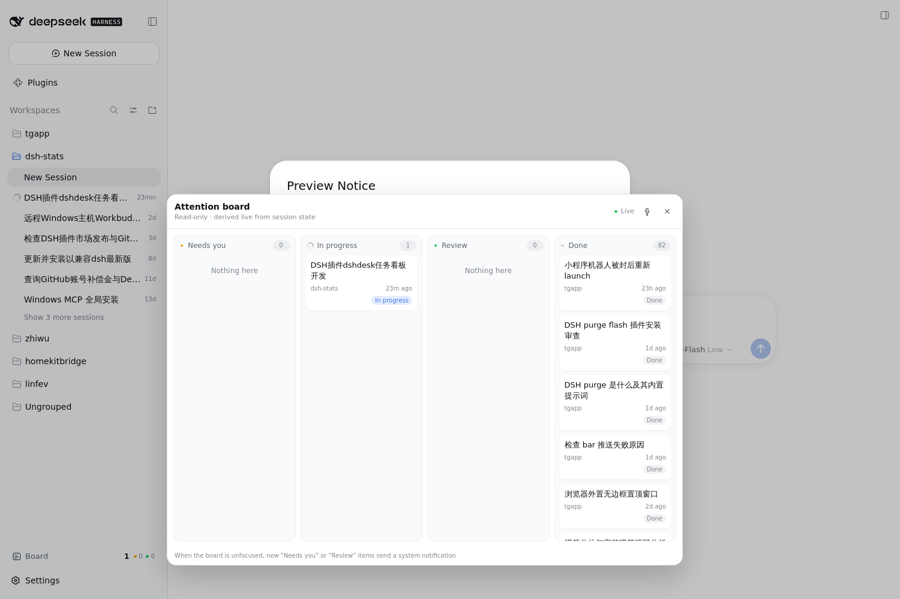
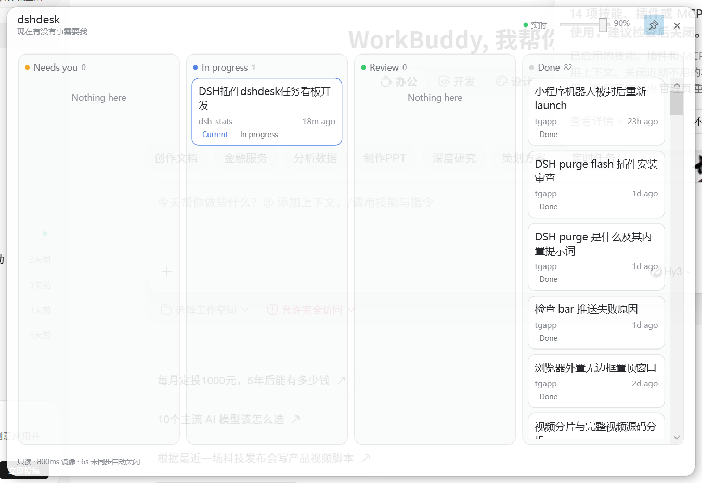

# dshdesk

> 一条注意力队列。只回答一个问题：**现在有没有事需要我？**





`dshdesk` 是 DeepSeek Harness 的只读任务看板。它把会话列表折成四栏——**需要你 / 进行中 / 验收 / 完成**——栏位完全由 DSH 自己的会话状态推导，不需要手动维护，也不会写回任何状态。侧边栏底部有一个总览按钮；点开是 860px 宽的实时气泡；在桌面端还可以钉成一个真正的 Windows 系统置顶小窗。

## 四栏怎么来

| 栏位 | 依据 | 与 DSH 一致的状态点 |
| --- | --- | --- |
| 需要你 | `pendingInteraction`（审批 / 计划待审 / 待回答） | 琥珀 |
| 进行中 | `running`，且没有待处理交互 | DSH ongoing 环 |
| 验收 | `completionUnread`（会话在你没看时完成） | 绿 |
| 完成 | 以上都不是 | 中性 |

- 空白会话、子代理会话、已归档会话不显示。
- 当前会话排在所属栏第一位，并带「当前」标记。
- 待处理交互优先于进行中，和 DSH 侧边栏的优先级一致。
- 卡片只读：不能拖到别的栏、不能手动完成、不会写入会话状态。

## 两个表面

### 侧边栏气泡（所有环境）

- 侧边栏底部按钮显示**活跃队列总数**（需要你 + 进行中 + 验收，不含完成），以及琥珀 / 绿色状态点；宽栏和 56px 窄栏都能用。总数为 0 就表示现在没有事需要你。
- 点开是 860px 气泡，贴在按钮右侧，四栏等宽；空栏写「暂无」。
- 气泡可拖动，`Esc` 或点击外部关闭。
- 只在看板未聚焦时，新进入「需要你」或「验收」的会话才发系统通知。

### 置顶小窗（仅桌面端 + Windows）

网页不会假装浏览器标签能置顶，因此按钮是否出现由两层判断共同决定：

1. 页面确实在 DSH 桌面壳里（`dshDesktop`、`data-windows-titlebar`、`dsh-app:` 等标记）；
2. 宿主能启动 Windows 原生窗口（Windows，或 WSL 里有 `powershell.exe`）。

满足时点图钉会打开一个 PowerShell 5.1 + WPF 的真窗口：

- 900 × 620，无边框，`Topmost`，最小 760 × 210；
- 默认 90% 透明度，头部滑块 30%–100% 可调，并记住上次的值；
- 800ms 拉取主窗快照；6 秒没有新快照就显示断线提示并关闭；
- 关闭后自动回到气泡；
- 浅 / 深色跟随宿主 `--dsw-*` token，不另造一套配色；
- 只读，没有任何会改会话状态的控件。

小窗由一个仅监听 `127.0.0.1`、带随机 token 的镜像服务供数；不经过公网，也没有额外的第三方请求。主题颜色使用 `#AARRGGBB`（WPF 顺序）传递，因此透明度边框不会在原生窗口里变色。

## 安装

```bash
dsh plugin --profile web add github:Pingze-github/dshdesk
# 或本地开发
dsh plugin --profile web add link:/mnt/f/DSH/dshdesk
```

安装后刷新页面。插件没有构建脚本、没有 `postinstall`，`client.js` 已是最终产物。

## 已知边界

- 置顶窗只支持 Windows + PowerShell 5.1 + WPF。macOS / Linux / 纯浏览器不会显示图钉。
- 小窗的实时性依赖主页面继续运行；主页面关闭或休眠超过 6 秒，小窗按设计关闭。
- 原生窗口日志在 `%TEMP%\dshdesk-window.log`。
- 浏览器通知需要在点击看板时授权；已被系统 / 浏览器禁用时不会弹。
- 看板不持久化卡片状态，因为它不拥有状态。

## 开发

```bash
bash scripts/check.sh        # 唯一成功标准
bash scripts/smoke.sh        # 热挂载 + 路由冒烟
node scripts/build-client.mjs
```

结构：

- `index.js` — 宿主：路由、快照存储、镜像服务、WPF 启动器。
- `lib/board.cjs` — 纯四栏推导 + 快照清洗；Node 测试与浏览器共用。
- `src/client.template.js` — 浏览器源码；生成 `client.js`。
- `native/dshdesk-window.ps1` — WPF 置顶窗。
- `scripts/build-client.mjs` — 把 `lib/board.cjs` 内联进单文件 bundle。

## License

MIT
